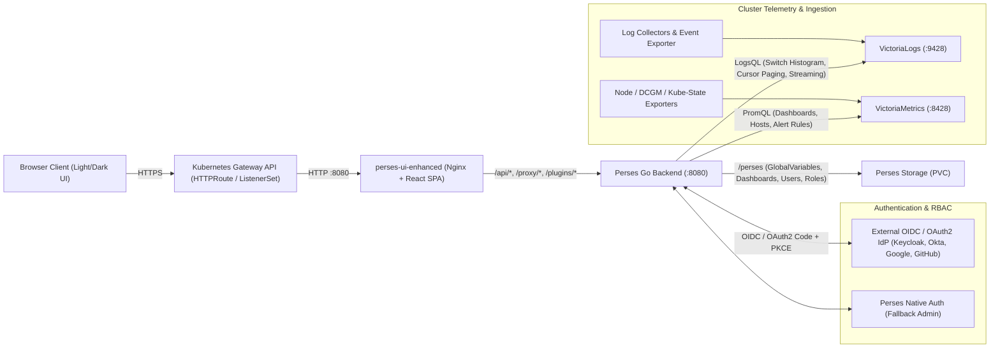

# perses-ui-enhanced

An enhanced, Nightingale-inspired open-source React UI shell and turnkey Kubernetes umbrella Helm chart combining **Perses** (untouched upstream Go backend + embedded `@perses-dev/*` modules), **VictoriaMetrics**, and **VictoriaLogs** into one unified observability stack.

---

## Architecture Overview



- **Untouched Upstream Perses Backend**: Uses official `persesdev/perses` (`v0.55.1+`) for authentication, RBAC, dashboards, projects, datasources, proxy routing, and remote plugin serving.
- **Forward-Compatible Perses SDK Architecture**:
  - Custom views (`Logs`, `Hosts`, `Alert rules`, `Events`, `Data sources`, `Users`, `Roles`, `Site settings`) use stable `/api/v1/*` and `/proxy/*` HTTP contracts via `@perses-dev/client` (`buildProxyUrl`, `UserFriendlyError`, `FetchError`) and `@perses-dev/components` (`formatValue`).
  - `/plugins/*` is proxied directly from the running Perses server so panel and datasource plugins stay dynamic.
  - Embedded `<ViewDashboard>` and `<ViewExplore>` use `@perses-dev/*` Module Federation singletons with a tested ESM/`__esModule` interop contract (`ui/src/app/perses/federation-chunk.ts`); only major/minor plugin-system API changes require bumping `@perses-dev/*` in `ui/package.json`.
- **Hardened Nginx + `njs` Gateway (`ui/deploy/nginx/`)**:
  - Enforces server-side authentication, trusted-proxy header stripping (`$trusted_proxy` CIDR allowlist), structured JSON audit logging, and server-side tenant namespace scoping on `/proxy/*` (PromQL, LogsQL, Jaeger/Tempo) via `njs/audit.js`.
  - Enforces admin-managed **Guest Role** + opaque `?share=<token>` public dashboard/panel embeds scoped to the published tenant namespace(s).

---

## Features

- **Unified Navigation & Dual Theme**: Crisp Light and Dark themes across MUI components and ECharts panels.
- **Dynamic Site Branding & SSO Config Generator (`System → Site settings`)**: Customize the application name, subtitle/description, organization label, monogram badge, or upload a custom PNG/SVG/JPG/WebP logo directly in the UI (persisted cluster-wide in Perses `GlobalVariable` `site_branding_config` and cached locally for the login screen). Includes an **SSO & Identity Providers** panel to inspect active `/api/config` providers and generate ready-to-paste Helm `values.yaml` + Callback URI snippets for **Keycloak**, **Generic OIDC**, **Google**, and **GitHub**.
- **Dual Authentication (OIDC / OAuth2 SSO + Native Fallback)**: Automatically renders configured SSO login buttons (`Sign in with <Provider Name>`) alongside native username/password authentication. *(Note: Perses separates native users from OAuth/OIDC users by username — e.g., keep `admin` as a local native break-glass account and sign in via SSO with your personal/company user, then assign roles under `Organization → Users`.)*
- **UI-Driven Data Sources (`Integrations → Data sources`)**: Create, edit, delete, and live-probe both Global Datasources and Project Datasources directly in the UI — supports deploying with zero pre-configured datasources (`persesProvisioning.enabled=false`).
- **Local Users & RBAC (`Organization → Users` & `Roles`)**: Create/edit/delete local native users, assign Global Roles and Per-Project Roles (`admin`, `editor`, `viewer`, or custom roles) to both native and SSO users, and manage GlobalRoles & Project Roles directly in the UI.
- **Projects, Interactive Dashboards & Grafana Import (`Dashboards`)**: Create/delete Perses projects, create blank dashboards, clone existing dashboards, or import Perses JSON and **Grafana Dashboard JSON** (auto-detected and converted via Perses `/api/migrate`), plus interactive edit & save (`PUT /api/v1/projects/{p}/dashboards/{d}`) via embedded `@perses-dev/dashboards`.
- **VictoriaLogs Explorer (`Explorer → Logs`)**:
  - Multi-tab LogsQL query editor with cluster-wide shared custom presets (`GlobalVariable: log_presets_config`), dynamic datasource selector, and time range selector.
  - Server-side log level filtering (`Error`, `Warning`, `Info`, `Debug`, `Other`) and single-pass `switch()` stacked severity bar histogram with click-to-zoom bucket selection.
  - **Keyset Cursor Pagination (`Latest`, `← Newer`, `Older →`)**: Keeps browser DOM/RAM flat while stepping through millions of logs.
  - **Chunked Streaming Export**: Export up to 20,000 logs (CSV/JSON) or 50,000 logs (low-RAM JSONL/NDJSON) in 1,000-row batches with live progress and cancellation.
  - Clean wrapping log stream, inline expandable structured fields (`▸` / `▾`), and a right-side **Log Detail Drawer** (`Small` / `Medium` / `Large`, **Table** / **JSON** tabs, clipboard copy, `+ filter` chips, and `↑` / `↓` / `Esc` keyboard navigation).
- **Distributed Tracing (`Explorer → Traces`)**: Query Jaeger v1, Jaeger v2 (`/api/v3` OTLP JSON), VictoriaTraces, or Tempo datasources via Perses Proxy with service/operation/tag/duration filters, interactive span waterfall drawer, span attributes inspector, and one-click **Search in Logs** correlation.
- **Embedded Perses Dashboards & Metrics Explorer**: Powered by `@perses-dev/dashboards`, `@perses-dev/explore`, `@perses-dev/plugin-system`, `@perses-dev/client`, and `@perses-dev/components`.
- **Infrastructure Hosts & Configurable Alert Rules**: Real-time node CPU, memory, uptime, OS detection badges (Linux, Windows, macOS), Kubernetes node metadata, and NVIDIA DCGM GPU utilization queried from any configured Prometheus/VictoriaMetrics datasource, plus persistent Create/Edit/Delete/Enable-Disable alert rules (`GlobalVariable: alert_rules_config`) evaluated live against PromQL or LogsQL datasources and cluster events.
- **Flexible Gateway Ingress**: Supports standard `HTTPRoute` or an optional dedicated-port HTTPS `ListenerSet` (`observabilityUi.listenerSet.enabled=true`) for IP-based access (e.g. `https://<LB_IP>:50811`) without external DNS.

---

## Repository Layout

```
.
├── .github/workflows/ci.yml    # Automated Vitest, ESLint, TypeScript & Vite build CI
├── helm/
│   └── perses-observability/   # Turnkey umbrella Helm chart (VictoriaLogs + VictoriaMetrics + Perses + UI)
├── ui/
│   ├── deploy/nginx/           # Hardened Nginx config & njs gateway (audit.js + Vitest tests)
│   ├── src/
│   │   ├── app/                # App shell, layout, router, providers, Perses SDK federation interop
│   │   ├── components/ui/      # Shared UI primitives (ViewStates, JsonViewer)
│   │   ├── features/           # Isolated feature modules (auth, dashboards, logs, metrics, traces, alerts, hosts, datasources, users, roles, site-settings, workspace)
│   │   ├── lib/                # API clients, queryKeys, RBAC, workspace isolation, unit formatting, CSV/JSON export
│   │   └── theme/              # Light/Dark MUI & ECharts theme
│   └── Dockerfile              # Multi-stage Node 24 -> unprivileged Nginx 1.27 + njs image
└── README.md
```

---

## Quick Start (Helm Chart Deployment)

### Prerequisites
- Kubernetes `1.26+`
- Helm `3.12+`
- A default `StorageClass` in the cluster (or specify `storageClassName` / `storageClass` in values)

### 1. Build Chart Dependencies
```bash
cd helm/perses-observability
helm dependency build
```

### 2. Deploy the Full Stack
Override the default secrets and admin password before installing in shared environments:

```bash
helm upgrade --install observability ./helm/perses-observability \
  --namespace observability \
  --create-namespace \
  --set persesAuth.nativeAdminPassword="your-strong-password" \
  --set persesAuth.encryptionKey="exactly-32-byte-aes256-secretkey"
```

### 3. Access the UI
```bash
kubectl port-forward -n observability svc/perses-ui-enhanced 8080:8080
```
Open `http://localhost:8080` and sign in with:
- **Username**: `admin` (from `persesAuth.nativeAdminUsername`)
- **Password**: `changeme` (from `persesAuth.nativeAdminPassword`, override on install!)

---

## Distributed Tracing (Jaeger / VictoriaTraces / Tempo)

### 1. Optional Built-in Jaeger v2 Deployment
The `perses-observability` Helm chart includes an optional, disabled-by-default Jaeger v2 (`2.23.0`) all-in-one Deployment & Service (Apache 2.0):

```bash
helm upgrade --install observability ./helm/perses-observability \
  --namespace observability \
  --reuse-values \
  --set jaeger.enabled=true
```

This exposes OTLP gRPC (`4317`), OTLP HTTP (`4318`), and Query HTTP (`16686`) on `svc/jaeger.<namespace>.svc.cluster.local`.

### 2. Add the Trace Data Source in the UI
No static provisioning is required. Go to **Integrations → Data sources → + Add data source**:
- **Plugin Kind**:
  - `Jaeger / VictoriaTraces (JaegerDatasource)` — works with Jaeger v1 (`/api/services`), Jaeger v2 (`/api/v3/services` OTLP JSON), and VictoriaTraces (`/select/jaeger` or Jaeger-compatible query endpoint).
  - `Tempo Traces (TempoDatasource)` — works with Grafana Tempo (`/api/search`).
- **Endpoint URL** examples:
  - Jaeger in-cluster: `http://jaeger.observability.svc.cluster.local:16686`
  - VictoriaTraces in-cluster: `http://<victoria-traces-svc>:10428/select/jaeger`
- Click **Test** to verify live connectivity, then open **Explorer → Traces**.

### 3. Instrumenting Applications (OTLP)
Any service exporting OpenTelemetry traces to the collector/Jaeger OTLP receiver automatically appears in the **Service** dropdown in **Explorer → Traces**:

```bash
OTEL_SERVICE_NAME=my-service
OTEL_EXPORTER_OTLP_ENDPOINT=http://jaeger.observability.svc.cluster.local:4318
OTEL_EXPORTER_OTLP_PROTOCOL=http/protobuf
```

- **Log Correlation (`Search in Logs`)**: Clicking **Search in Logs** inside the Span Waterfall Drawer opens **Explorer → Logs** pre-filled with the selected `traceId`. Matching logs appear whenever your application logger (or OTel log bridge) includes the `trace_id` in structured JSON fields or the log message.

---

## Multi-Tenancy, OIDC Viewer Mode & Workspace Scoping

### 1. Viewer-Only Role (Query & View Without Admin/Write Access)
All write/admin UI controls are gated by Perses RBAC permissions (`/api/v1/users/{username}/permissions`):
- **Organization (`Users`, `Roles`)** and **System → Site settings** are hidden from non-admin users.
- **Dashboards** opens in read-only mode (`isReadonly`), hiding **New project**, **New dashboard**, **Edit**, **Clone**, and **Delete**.
- **Integrations → Data sources** and **Alerting → Rules** stay read-only, hiding **Add / Edit / Delete** buttons.
- **Explorer (`Metrics`, `Logs`, `Traces`)** and **Infrastructure (`Hosts`, `Events`)** remain open for querying.

To grant OIDC users Viewer access automatically on first login, either:
- **Option A (Per-workspace isolation)**: Assign the user a Perses Project `RoleBinding` (e.g. `viewer` role with `read` on `Dashboard`, `Datasource`, `Variable`) on their specific Project under **Organization → Users** (or via Perses API `/api/v1/projects/{project}/rolebindings`).
- **Option B (Viewer-by-default for all OIDC users)**: Uncomment the `guest_permissions` block in `helm/perses-observability/values.yaml` (`actions: ["read"]`, `scopes: ["Project", "Dashboard", "Datasource", "GlobalDatasource", "Variable"]`).

### 2. Server-Side Tenant Isolation & Workspace Scoping
- **Standalone Docker / non-Kubernetes**: Works with zero namespace assumptions. Perses **Projects** are the native isolation boundary.
- **Kubernetes / OtterScale Workspace Isolation**: When `/tmp/workspace-map.json` is mounted (supporting both `WorkspaceList` and `NamespaceList` formats, as well as OIDC subject UUID matching), **both** the React UI and the Nginx `njs` gateway (`ui/deploy/nginx/njs/audit.js`) verify the caller's Perses permissions and automatically inject tenant namespace filters into every `/proxy/*` PromQL, LogsQL, and Jaeger/Tempo query. Admin users remain unscoped.
- **Admin-Managed Guest Role & Scoped Public Embeds**:
  - In **System → Site settings → Role View Permissions**, enable **Dashboards (Overview)** for the `guest` role (disabled by default).
  - In any dashboard's **Share & Embed** modal, site admins can select **Public (Guest Role + Token)**, pick a **Tenant Namespace Scope** (`*` or a specific namespace), and publish or revoke an opaque `?share=<token>` link (stored in Perses `GlobalVariable` `perses_ui_public_shares`).
  - Nginx `njs` validates `X-Perses-Share-Token` against `role_view_permissions_config` and `perses_ui_public_shares`, permits read-only `/api/v1/` access strictly for that shared dashboard and its datasources/variables, and enforces the token's `allowedNamespaces` on every `/proxy/` query.

---

## Building & Testing the Custom UI Container

```bash
docker build -t ghcr.io/aimanhaziqmy/perses-ui-enhanced:v1.1.48 ./ui
```

### Local UI Development & Quality Checks
Run a Perses backend locally (default `http://localhost:8080`) or update the proxy target in `ui/vite.config.ts`, then:

```bash
cd ui
npm ci
npm run dev

# Verification suite
npm test          # Vitest unit tests (workspace isolation, njs gateway, logs, units, public shares, SDK interop)
npm run lint      # ESLint + feature-boundary enforcement
npm run typecheck # TypeScript --noEmit
npm run build     # Production Vite bundle
```

