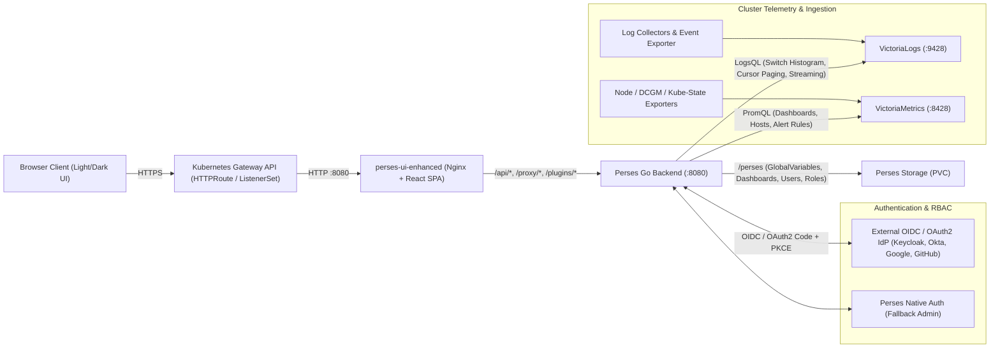

# perses-ui-enhanced

An enhanced, Nightingale-inspired open-source React UI shell and turnkey Kubernetes umbrella Helm chart combining **Perses** (untouched upstream Go backend + embedded `@perses-dev/*` modules), **VictoriaMetrics**, and **VictoriaLogs** into one unified observability stack.

---

## Architecture Overview



- **Untouched Upstream Perses Backend**: Uses official `persesdev/perses` (`v0.55.1+`) for authentication, RBAC, dashboards, projects, datasources, proxy routing, and remote plugin serving.
- **Forward-Compatible UI Design**:
  - Custom views (`Logs`, `Hosts`, `Alert rules`, `Events`, `Data sources`, `Users`, `Roles`, `Site settings`) use stable `/api/v1/*` and `/proxy/*` HTTP contracts and work across future Perses versions without rebuilding the UI.
  - `/plugins/*` is proxied directly from the running Perses server so panel and datasource plugins stay dynamic.
  - Embedded `<ViewDashboard>` and `<ViewExplore>` use `@perses-dev/*` Module Federation singletons with an ESM/`__esModule` interop bridge; only major/minor plugin-system API changes require bumping `@perses-dev/*` in `ui/package.json`.

---

## Features

- **Unified Navigation & Dual Theme**: Crisp Light and Dark themes across MUI components and ECharts panels.
- **Dynamic Site Branding & SSO Config Generator (`System → Site settings`)**: Customize the application name, subtitle/description, organization label, monogram badge, or upload a custom PNG/SVG/JPG/WebP logo directly in the UI (persisted cluster-wide in Perses `GlobalVariable` `site_branding_config` and cached locally for the login screen). Includes an **SSO & Identity Providers** panel to inspect active `/api/config` providers and generate ready-to-paste Helm `values.yaml` + Callback URI snippets for **Keycloak**, **Generic OIDC**, **Google**, and **GitHub**.
- **Dual Authentication (OIDC / OAuth2 SSO + Native Fallback)**: Automatically renders configured SSO login buttons (`Sign in with <Provider Name>`) alongside native username/password authentication. *(Note: Perses separates native users from OAuth/OIDC users by username — e.g., keep `admin` as a local native break-glass account and sign in via SSO with your personal/company user, then assign roles under `Organization → Users`.)*
- **UI-Driven Data Sources (`Integrations → Data sources`)**: Create, edit, delete, and live-probe both Global Datasources and Project Datasources directly in the UI — supports deploying with zero pre-configured datasources (`persesProvisioning.enabled=false`).
- **Local Users & RBAC (`Organization → Users` & `Roles`)**: Create/edit/delete local native users, assign Global Roles and Per-Project Roles (`admin`, `editor`, `viewer`, or custom roles) to both native and SSO users, and manage GlobalRoles & Project Roles directly in the UI.
- **Projects, Interactive Dashboards & Grafana Import (`Dashboards`)**: Create/delete Perses projects, create blank dashboards, clone existing dashboards, or import Perses JSON and **Grafana Dashboard JSON** (auto-detected and converted via Perses `/api/migrate`), plus interactive edit & save (`PUT /api/v1/projects/{p}/dashboards/{d}`) via embedded `@perses-dev/dashboards`.
- **VictoriaLogs Explorer (`Explorer → Logs`)**:
  - Multi-tab LogsQL query editor with cluster-wide shared custom presets (`GlobalVariable: log_presets_config`), dynamic datasource selector, and time range selector.
  - Server-side log level filtering (`Error`, `Warning`, `Info`, `Debug`, `Other`) and single-pass `switch()` stacked severity bar histogram with click-to-zoom bucket selection.
  - **Keyset Cursor Pagination (`Latest`, `← Newer`, `Older →`)**: Keeps browser DOM/RAM flat while stepping through millions of logs.
  - **Chunked Streaming Export**: Export up to 20,000 logs (CSV/JSON) or 50,000 logs (low-RAM JSONL/NDJSON) in 1,000-row batches with live progress and cancellation.
  - Clean wrapping log stream, inline expandable structured fields (`▸` / `▾`), and a right-side **Log Detail Drawer** (`Small` / `Medium` / `Large`, **Table** / **JSON** tabs, clipboard copy, `+ filter` chips, and `↑` / `↓` / `Esc` keyboard navigation).
- **Embedded Perses Dashboards & Metrics Explorer**: Powered by `@perses-dev/dashboards`, `@perses-dev/explore`, `@perses-dev/plugin-system`, `@perses-dev/client`, and `@perses-dev/components`.
- **Infrastructure Hosts & Configurable Alert Rules**: Real-time node CPU, memory, uptime, OS detection badges (Linux, Windows, macOS), Kubernetes node metadata, and NVIDIA DCGM GPU utilization queried from any configured Prometheus/VictoriaMetrics datasource, plus persistent Create/Edit/Delete/Enable-Disable alert rules (`GlobalVariable: alert_rules_config`) evaluated live against PromQL or LogsQL datasources and cluster events.
- **Flexible Gateway Ingress**: Supports standard `HTTPRoute` or an optional dedicated-port HTTPS `ListenerSet` (`observabilityUi.listenerSet.enabled=true`) for IP-based access (e.g. `https://<LB_IP>:50811`) without external DNS.

---

## Repository Layout

```
.
├── helm/
│   └── perses-observability/   # Turnkey umbrella Helm chart (VictoriaLogs + VictoriaMetrics + Perses + UI)
├── ui/                         # perses-ui-enhanced React + TypeScript + Vite source & Dockerfile
└── README.md
```

---

## Quick Start (Helm Chart Deployment)

### Prerequisites
- Kubernetes `1.26+`
- Helm `3.12+`
- A default `StorageClass` in the cluster (or specify `storageClassName` / `storageClass` in values)

### 1. Build Chart Dependencies
```bash
cd helm/perses-observability
helm dependency build
```

### 2. Deploy the Full Stack
Override the default secrets and admin password before installing in shared environments:

```bash
helm upgrade --install observability ./helm/perses-observability \
  --namespace observability \
  --create-namespace \
  --set persesAuth.nativeAdminPassword="your-strong-password" \
  --set persesAuth.encryptionKey="exactly-32-byte-aes256-secretkey"
```

### 3. Access the UI
```bash
kubectl port-forward -n observability svc/perses-ui-enhanced 8080:8080
```
Open `http://localhost:8080` and sign in with:
- **Username**: `admin` (from `persesAuth.nativeAdminUsername`)
- **Password**: `changeme` (from `persesAuth.nativeAdminPassword`, override on install!)

---

## Building the Custom UI Container

```bash
docker build -t ghcr.io/aimanhaziqmy/perses-ui-enhanced:v1.0.0 ./ui
```

### Local UI Development
Run a Perses backend locally (default `http://localhost:8080`) or update the proxy target in `ui/vite.config.ts`, then:

```bash
cd ui
npm install
npm run dev
```

